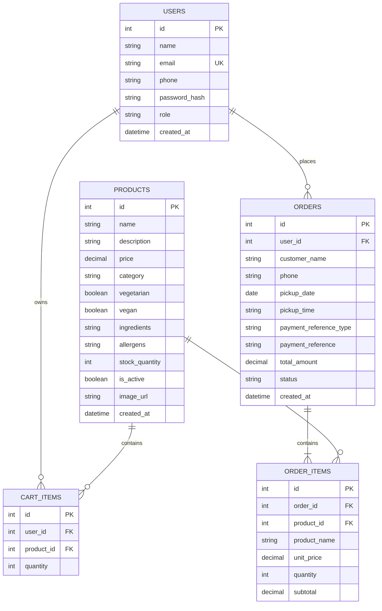
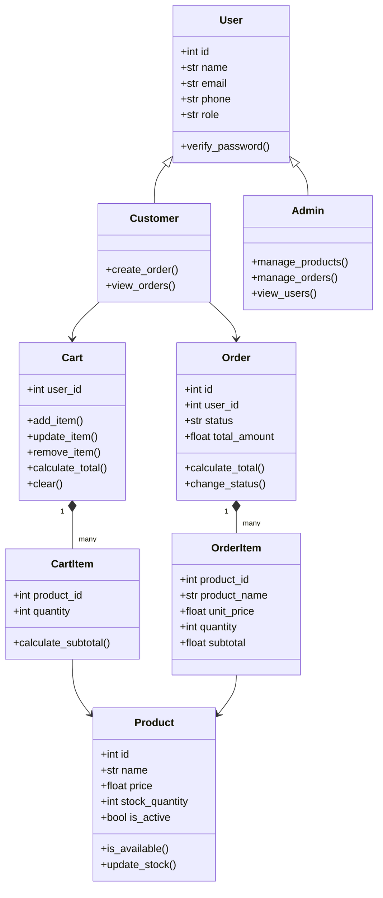
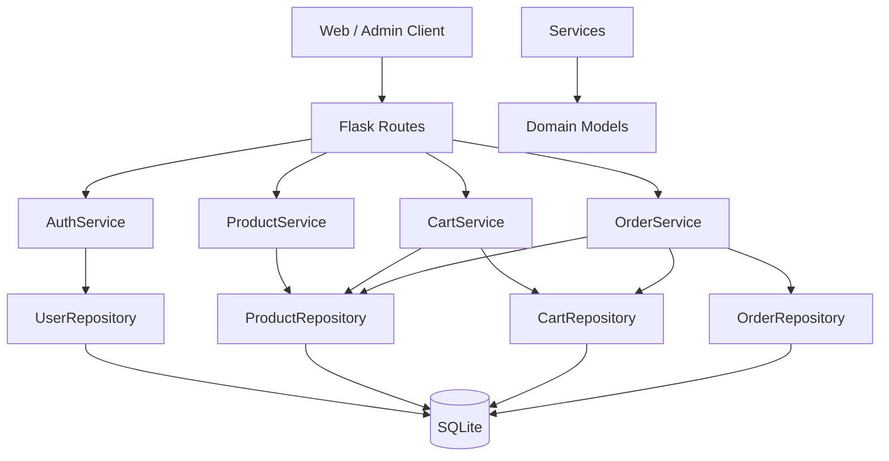

# GreenBite Server Design v0.1

**Project:** GreenBite Vegetarian & Plant-Based Pre-order Platform  
**Component:** Backend Server  
**Version:** v0.1  
**Status:** Design Baseline / MVP  
**Technology:** Python, Flask, SQLite, REST API

---

## 1. Purpose

The GreenBite Server provides RESTful APIs for the customer web application and administrator application.

The server is responsible for:

- User registration and authentication
- Product management
- Shopping cart management
- Order creation and management
- Stock management
- Order status management
- User management
- Business rule validation
- Data persistence using SQLite

The server follows an Object-Oriented design with separation between:

```text
Routes
  ↓
Services
  ↓
Repositories
  ↓
SQLite Database
```

---

# 2. MVP Scope

## Included

### Customer

- Register
- Login
- View available products
- View product details
- Add products to cart
- Update cart quantity
- Remove cart items
- Submit an order
- View own orders
- View order details

### Administrator

- Login
- View users
- Create products
- Edit products
- Publish / unpublish products
- Update stock
- View orders
- View order details
- Update order status

## Not Included in MVP

- Guest checkout
- Online payment gateway
- Delivery
- Driver management
- Real-time delivery tracking
- Customer loyalty system
- Complex inventory management
- Customer account deletion
- Password reset
- AI recommendation
- Real business deployment

Guest checkout may be considered as a future enhancement.

---

# 3. Architecture

The server uses a layered architecture.

```text
                    ┌──────────────────────┐
                    │      Web Client      │
                    │  Customer / Admin    │
                    └──────────┬───────────┘
                               │
                         HTTP / JSON
                               │
                               ▼
                    ┌──────────────────────┐
                    │    Flask Routes      │
                    │  API / HTTP Layer    │
                    └──────────┬───────────┘
                               │
                               ▼
                    ┌──────────────────────┐
                    │      Services        │
                    │ Business Logic Layer │
                    └──────────┬───────────┘
                               │
                               ▼
                    ┌──────────────────────┐
                    │    Repositories      │
                    │   Data Access Layer  │
                    └──────────┬───────────┘
                               │
                               ▼
                    ┌──────────────────────┐
                    │       SQLite         │
                    │      Database        │
                    └──────────────────────┘
```

## Design Principle

Routes should handle HTTP concerns only.

Routes should NOT directly perform SQL queries or contain complex business logic.

Example:

```text
Route
  ↓
OrderService.create_order()
  ↓
OrderRepository
  ↓
SQLite
```

---

# 4. Technology Stack

| Component | Technology |
|---|---|
| Language | Python 3 |
| Web Framework | Flask |
| Database | SQLite |
| API | REST / JSON |
| Authentication | JWT |
| Password Hashing | Werkzeug password hashing |
| Testing | pytest |
| Version Control | Git / GitHub |
| API Testing | Postman or similar tool |

---

# 5. Base API URL

```text
/api/v1
```

Example:

```text
POST /api/v1/auth/login
```

---

# 6. Authentication

Authenticated requests use:

```http
Authorization: Bearer <JWT_TOKEN>
```

There are two main roles:

```text
customer
admin
```

A newly registered user is always created as:

```text
role = customer
```

The client must not be allowed to specify the role during registration.

---

# 7. API Overview

| # | Method | Endpoint | Authentication |
|---|---|---|---|
| 01 | POST | `/api/v1/auth/register` | Public |
| 02 | POST | `/api/v1/auth/login` | Public |
| 03 | GET | `/api/v1/auth/me` | Customer/Admin |
| 04 | GET | `/api/v1/products` | Public |
| 05 | GET | `/api/v1/products/<id>` | Public |
| 06 | POST | `/api/v1/admin/products` | Admin |
| 07 | PUT | `/api/v1/admin/products/<id>` | Admin |
| 08 | PATCH | `/api/v1/admin/products/<id>/status` | Admin |
| 09 | PATCH | `/api/v1/admin/products/<id>/stock` | Admin |
| 10 | GET | `/api/v1/cart` | Customer |
| 11 | POST | `/api/v1/cart/items` | Customer |
| 12 | PATCH | `/api/v1/cart/items/<product_id>` | Customer |
| 13 | DELETE | `/api/v1/cart/items/<product_id>` | Customer |
| 14 | POST | `/api/v1/orders` | Customer |
| 15 | GET | `/api/v1/orders/my` | Customer |
| 16 | GET | `/api/v1/orders/<id>` | Customer |
| 17 | GET | `/api/v1/admin/orders` | Admin |
| 18 | GET | `/api/v1/admin/orders/<id>` | Admin |
| 19 | PATCH | `/api/v1/admin/orders/<id>/status` | Admin |
| 20 | GET | `/api/v1/admin/users` | Admin |

Total MVP endpoints:

**20**

---

# 8. Authentication APIs

## 8.1 Register

### Endpoint

```http
POST /api/v1/auth/register
```

### Request

```json
{
  "name": "Richard",
  "email": "richard@example.com",
  "phone": "0212345678",
  "password": "Password123"
}
```

### Response

HTTP 201

```json
{
  "message": "User registered successfully",
  "user": {
    "id": 1,
    "name": "Richard",
    "email": "richard@example.com",
    "phone": "0212345678",
    "role": "customer"
  }
}
```

### Business Rules

- Email must be unique.
- Password must be hashed.
- Password must never be returned by the API.
- New users are always assigned `customer`.
- The client cannot submit or modify the role during registration.

---

# 9. Login

## Endpoint

```http
POST /api/v1/auth/login
```

### Request

```json
{
  "email": "richard@example.com",
  "password": "Password123"
}
```

### Response

HTTP 200

```json
{
  "message": "Login successful",
  "token": "<JWT_TOKEN>",
  "user": {
    "id": 1,
    "name": "Richard",
    "email": "richard@example.com",
    "role": "customer"
  }
}
```

---

# 10. Current User

## Endpoint

```http
GET /api/v1/auth/me
```

### Authentication

Required.

### Response

```json
{
  "id": 1,
  "name": "Richard",
  "email": "richard@example.com",
  "phone": "0212345678",
  "role": "customer"
}
```

---

# 11. Product APIs

## 11.1 Get Products

```http
GET /api/v1/products
```

Public users receive active products only.

Administrators may optionally request inactive products for management purposes.

Example:

```http
GET /api/v1/products?include_inactive=true
```

### Response

```json
{
  "products": [
    {
      "id": 1,
      "name": "Walnut Raisin Bread",
      "description": "Homemade bread with walnuts and raisins.",
      "price": 11.0,
      "category": "Bread",
      "vegetarian": true,
      "vegan": true,
      "ingredients": "Flour, walnuts, raisins",
      "allergens": "Wheat, nuts",
      "stock_quantity": 8,
      "is_active": true,
      "image_url": "/images/walnut-bread.jpg"
    }
  ]
}
```

---

# 12. Get Product

```http
GET /api/v1/products/<product_id>
```

### Response

```json
{
  "id": 1,
  "name": "Walnut Raisin Bread",
  "description": "Homemade bread with walnuts and raisins.",
  "price": 11.0,
  "category": "Bread",
  "vegetarian": true,
  "vegan": true,
  "ingredients": "Flour, walnuts, raisins",
  "allergens": "Wheat, nuts",
  "stock_quantity": 8,
  "is_active": true,
  "image_url": "/images/walnut-bread.jpg"
}
```

---

# 13. Create Product

## Endpoint

```http
POST /api/v1/admin/products
```

### Authentication

Admin only.

### Request

```json
{
  "name": "Pumpkin Cake",
  "description": "Homemade pumpkin cake.",
  "price": 12.0,
  "category": "Cake",
  "vegetarian": true,
  "vegan": false,
  "ingredients": "Pumpkin, flour",
  "allergens": "Wheat, soy",
  "stock_quantity": 10,
  "image_url": "/images/pumpkin-cake.jpg"
}
```

### Response

HTTP 201

```json
{
  "message": "Product created successfully",
  "product": {
    "id": 2,
    "name": "Pumpkin Cake",
    "price": 12.0,
    "stock_quantity": 10,
    "is_active": true
  }
}
```

---

# 14. Update Product

```http
PUT /api/v1/admin/products/<product_id>
```

### Authentication

Admin only.

### Request

```json
{
  "name": "Pumpkin Cake",
  "description": "Updated description.",
  "price": 13.0,
  "category": "Cake",
  "vegetarian": true,
  "vegan": false,
  "ingredients": "Pumpkin, flour",
  "allergens": "Wheat",
  "image_url": "/images/pumpkin-cake.jpg"
}
```

---

# 15. Publish / Unpublish Product

```http
PATCH /api/v1/admin/products/<product_id>/status
```

### Request

```json
{
  "is_active": false
}
```

---

# 16. Update Product Stock

```http
PATCH /api/v1/admin/products/<product_id>/stock
```

### Request

```json
{
  "stock_quantity": 15
}
```

### Business Rules

- Stock cannot be negative.
- Only administrators can modify stock.
- Products with zero stock cannot be added to a cart.
- Inactive products cannot be added to a cart.

---

# 17. Cart APIs

The MVP requires customer authentication before shopping.

Guest shopping is not included in the MVP.

Cart data is associated with the authenticated customer.

---

# 18. Get Current User Cart

```http
GET /api/v1/cart
```

### Response

```json
{
  "items": [
    {
      "product_id": 1,
      "product_name": "Walnut Raisin Bread",
      "unit_price": 11.0,
      "quantity": 2,
      "subtotal": 22.0
    }
  ],
  "total": 22.0
}
```

---

# 19. Add Cart Item

```http
POST /api/v1/cart/items
```

### Request

```json
{
  "product_id": 1,
  "quantity": 2
}
```

### Business Rules

- Product must exist.
- Product must be active.
- Quantity must be greater than zero.
- Requested quantity must not exceed available stock.
- If the product already exists in the cart, its quantity should be updated rather than creating a duplicate cart item.

---

# 20. Update Cart Item

```http
PATCH /api/v1/cart/items/<product_id>
```

### Request

```json
{
  "quantity": 3
}
```

---

# 21. Remove Cart Item

```http
DELETE /api/v1/cart/items/<product_id>
```

### Response

```json
{
  "message": "Item removed from cart"
}
```

---

# 22. Order APIs

Orders are created from the authenticated customer's cart.

---

# 23. Create Order

```http
POST /api/v1/orders
```

### Authentication

Customer only.

### Request

```json
{
  "customer_name": "Richard",
  "phone": "0212345678",
  "pickup_date": "2026-10-10",
  "pickup_time": "15:00",
  "payment_reference_type": "bank_transfer",
  "payment_reference": "12345"
}
```

### Payment Reference

The MVP does NOT collect full bank-card information.

Supported reference types may include:

```text
bank_transfer
phone
```

The `payment_reference` is only a short reference used by the bakery to identify the customer's payment.

### Server Processing

The server must:

1. Identify the authenticated user.
2. Load the user's cart.
3. Verify that the cart is not empty.
4. Verify that every product is still active.
5. Verify stock availability.
6. Obtain current product prices from the database.
7. Calculate order totals on the server.
8. Create the Order.
9. Create OrderItems.
10. Reduce product stock.
11. Clear the customer's cart.
12. Commit the transaction.
13. Return the created order.

The client must NOT be trusted to provide the final order total.

---

# 24. My Orders

```http
GET /api/v1/orders/my
```

### Response

```json
{
  "orders": [
    {
      "id": 1001,
      "total_amount": 22.0,
      "pickup_date": "2026-10-10",
      "pickup_time": "15:00",
      "status": "pending",
      "created_at": "2026-10-07T20:30:00"
    }
  ]
}
```

---

# 25. Get Customer Order

```http
GET /api/v1/orders/<order_id>
```

### Security Rule

A customer can only access their own orders.

The server must verify:

```text
order.user_id == current_user.id
```

Otherwise return HTTP 403.

---

# 26. Admin Orders

## Get Orders

```http
GET /api/v1/admin/orders
```

Optional filter:

```http
GET /api/v1/admin/orders?status=pending
```

---

# 27. Admin Order Detail

```http
GET /api/v1/admin/orders/<order_id>
```

### Response

```json
{
  "id": 1001,
  "customer": {
    "name": "Richard",
    "phone": "0212345678"
  },
  "items": [
    {
      "product_name": "Walnut Raisin Bread",
      "unit_price": 11.0,
      "quantity": 2,
      "subtotal": 22.0
    }
  ],
  "total_amount": 22.0,
  "pickup_date": "2026-10-10",
  "pickup_time": "15:00",
  "payment_reference_type": "bank_transfer",
  "payment_reference": "12345",
  "status": "pending"
}
```

---

# 28. Update Order Status

```http
PATCH /api/v1/admin/orders/<order_id>/status
```

### Request

```json
{
  "status": "confirmed"
}
```

### Valid Statuses

```text
pending
confirmed
preparing
ready_for_pickup
collected
```

### Valid Status Flow

```text
Pending
   ↓
Confirmed
   ↓
Preparing
   ↓
Ready for Pickup
   ↓
Collected
```

Invalid status transitions should be rejected.

Example:

```text
Collected → Pending
```

is invalid.

---

# 29. Admin Users

```http
GET /api/v1/admin/users
```

### Response

```json
{
  "users": [
    {
      "id": 1,
      "name": "Richard",
      "email": "richard@example.com",
      "phone": "0212345678",
      "role": "customer",
      "created_at": "2026-10-07T10:00:00"
    }
  ]
}
```

Passwords and password hashes must never be returned.

---

# 30. Standard Error Response

All API errors should use a consistent format.

```json
{
  "error": {
    "code": "ERROR_CODE",
    "message": "Human-readable error message."
  }
}
```

---

## 30.1 400 Bad Request

```json
{
  "error": {
    "code": "INVALID_REQUEST",
    "message": "Quantity must be greater than zero."
  }
}
```

---

## 30.2 401 Unauthorized

```json
{
  "error": {
    "code": "UNAUTHORIZED",
    "message": "Please Login to access authorization."
  }
}
```

---

## 30.3 403 Forbidden

```json
{
  "error": {
    "code": "FORBIDDEN",
    "message": "Admin permission is required."
  }
}
```

---

## 30.4 404 Not Found

```json
{
  "error": {
    "code": "PRODUCT_NOT_FOUND",
    "message": "Product does not exist."
  }
}
```

---

## 30.5 409 Conflict

Example:

```json
{
  "error": {
    "code": "INSUFFICIENT_STOCK",
    "message": "Only 2 units are available."
  }
}
```

Other possible conflicts:

```text
EMAIL_ALREADY_EXISTS
INVALID_ORDER_STATUS
EMPTY_CART
```

---

# 31. Database Design

The MVP database contains five main tables.

```text
users
products
cart_items
orders
order_items
```

---

# 32. Entity Relationship Diagram



---

# 33. Important Order Design Decision

`order_items` stores:

```text
product_name
unit_price
quantity
subtotal
```

instead of relying only on the current Product record.

Reason:

Product information may change after an order has been created.

For example:

```text
Today:
Walnut Bread = $11

Later:
Walnut Bread = $13
```

An existing order must still show:

```text
Walnut Bread × 2
$11 each
$22 total
```

Therefore, OrderItem stores a snapshot of the relevant product information at the time of purchase.

---

# 34. OOP Design

## Main Domain Classes

```text
User
 ├── Customer
 └── Admin

Product

Cart
 └── CartItem

Order
 └── OrderItem
```

---

# 35. OOP Relationship Diagram



---

# 36. Layered OOP Architecture



---

# 37. Repository Layer

Repositories abstract database access.

Example:

```python
class ProductRepository:

    def get_by_id(self, product_id):
        pass

    def get_active_products(self):
        pass

    def create(self, product):
        pass

    def update(self, product):
        pass

    def update_stock(self, product_id, quantity):
        pass
```

The Service layer should not contain raw SQL where possible.

---

# 38. Service Layer

Services contain business logic.

Example:

```python
class OrderService:

    def create_order(
        self,
        user_id,
        customer_name,
        phone,
        pickup_date,
        pickup_time,
        payment_reference_type,
        payment_reference
    ):
        pass

    def get_user_orders(self, user_id):
        pass

    def get_order(self, order_id, user_id):
        pass

    def update_status(self, order_id, new_status):
        pass
```

---

# 39. Route Layer

Routes should be thin.

Example:

```python
@order_bp.post("/orders")
@jwt_required()
def create_order():

    user_id = get_jwt_identity()

    data = request.get_json()

    order = order_service.create_order(
        user_id=user_id,
        **data
    )

    return jsonify(order), 201
```

The route should not:

- calculate order totals
- execute SQL
- modify stock directly
- implement complex validation
- contain order status rules

These belong to the Service layer.

---

# 40. Business Rules

## BR-01 Product Availability

Only active products can be purchased.

```text
product.is_active == true
```

---

## BR-02 Stock Validation

The requested quantity must not exceed available stock.

```text
requested_quantity <= stock_quantity
```

---

## BR-03 Server-Side Pricing

The server calculates the final order total.

The client cannot determine the final price.

---

## BR-04 Stock Reduction

When an order is successfully created:

```text
product.stock_quantity -= ordered_quantity
```

---

## BR-05 Cart Clearing

After successful order creation:

```text
cart = empty
```

---

## BR-06 Customer Order Ownership

Customers may only view their own orders.

---

## BR-07 Admin Authorization

Only users with:

```text
role = admin
```

can access Admin APIs.

---

## BR-08 Product Management

Only Admin users can:

- create products
- update products
- publish products
- unpublish products
- update stock

---

## BR-09 Order Status

Order status must follow the defined workflow.

```text
pending
  ↓
confirmed
  ↓
preparing
  ↓
ready_for_pickup
  ↓
collected
```

---

## BR-10 Password Security

Passwords must be hashed.

Plaintext passwords must never be stored or returned.

---

## BR-11 Registration Security

Public registration always creates:

```text
role = customer
```

The client cannot create an Admin account.

---

## BR-12 Payment Security

The MVP does not collect full bank-card information.

Only a limited payment reference is stored.

---

# 41. Transaction Requirement

Order creation should be treated as a database transaction.

The following operations should succeed or fail together:

```text
Create Order
     +
Create Order Items
     +
Reduce Stock
     +
Clear Cart
```

If one operation fails, the transaction should be rolled back.

Example:

```text
Stock update fails
        ↓
Rollback Order
        ↓
Rollback OrderItems
        ↓
Keep Cart
```

---

# 42. Suggested Server Project Structure

```text
server/
│
├── app.py
├── run.py
├── config.py
├── requirements.txt
│
├── database/
│   ├── database.py
│   └── seed.py
│
├── models/
│   ├── __init__.py
│   ├── user.py
│   ├── product.py
│   ├── cart.py
│   ├── cart_item.py
│   ├── order.py
│   └── order_item.py
│
├── repositories/
│   ├── __init__.py
│   ├── user_repository.py
│   ├── product_repository.py
│   ├── cart_repository.py
│   └── order_repository.py
│
├── services/
│   ├── __init__.py
│   ├── auth_service.py
│   ├── product_service.py
│   ├── cart_service.py
│   └── order_service.py
│
├── routes/
│   ├── __init__.py
│   ├── auth_routes.py
│   ├── product_routes.py
│   ├── cart_routes.py
│   ├── order_routes.py
│   └── admin_routes.py
│
├── utils/
│   ├── auth.py
│   ├── validators.py
│   └── errors.py
│
└── tests/
    ├── test_auth.py
    ├── test_products.py
    ├── test_cart.py
    ├── test_orders.py
    └── test_admin.py
```

---

# 43. Testing Strategy

The server should include tests for:

## Authentication

- Successful registration
- Duplicate email
- Successful login
- Incorrect password
- Protected endpoint without token

## Products

- Get products
- Get product
- Product not found
- Admin create product
- Admin update product
- Publish / unpublish
- Invalid stock

## Cart

- Add item
- Update quantity
- Remove item
- Product unavailable
- Insufficient stock

## Orders

- Successful order
- Empty cart
- Insufficient stock
- Correct total calculation
- Stock reduction
- Cart clearing
- Customer cannot access another customer's order
- Invalid status transition

## Admin

- Admin can access Admin APIs
- Customer cannot access Admin APIs

Target:

```text
All tests passing
```

---

# 44. MVP Security Requirements

The server should:

- Hash passwords.
- Never return password hashes.
- Use authentication tokens for protected APIs.
- Enforce role-based authorization.
- Validate user ownership of orders.
- Validate stock on the server.
- Calculate prices on the server.
- Never trust client-submitted totals.
- Prevent customers from assigning themselves the Admin role.
- Avoid storing full bank-card information.

---

# 45. Future Enhancements

The following are intentionally outside the MVP:

## Guest Checkout

Allow customers to place an order without registering.

## Online Payment

Possible future integration with a payment provider.

## Delivery

Possible future features:

- delivery address
- delivery fee
- delivery zone
- delivery status
- driver assignment

## Customer Features

- password reset
- account profile editing
- order cancellation
- favourites
- loyalty system

---

# 46. MVP Prioritisation Decision

Guest checkout was considered during requirements analysis.

The team decided to require customer registration before checkout because this reduces implementation complexity while still supporting the core business goal of online pre-ordering.

This also simplifies:

- Cart ownership
- Order ownership
- Order history
- Authentication
- Testing
- Security

Guest checkout is recorded as a future enhancement rather than an MVP requirement.

---

# 47. Development Principle

The backend should be developed incrementally.

Recommended implementation order:

```text
1. Project foundation
        ↓
2. Database + Models
        ↓
3. Repository Layer
        ↓
4. Authentication
        ↓
5. Product APIs
        ↓
6. Cart APIs
        ↓
7. Order APIs
        ↓
8. Admin APIs
        ↓
9. Error handling
        ↓
10. Testing
```

The Web and Admin applications should consume the APIs defined in this document rather than directly accessing the database.

---

# 48. Design Status

**Version:** v0.1

**Status:** Proposed MVP baseline

Before implementation, the team should review:

- API endpoints
- Request / response structures
- Database design
- Business rules
- Authentication approach
- OOP architecture

Any changes should be recorded as a project decision in the team's Agile documentation.

---